  
  
  
  

 

  

<picture>
  <source media="(prefers-color-scheme: dark)" srcset="./assets/cap-01-dark.svg">
  
</picture>

**Por el camino**

- 🏆 **3.er puesto nacional — Global Hack 2025**, reto "El Futuro del Seguro" (Global Seguros & Design Factory Javeriana). [Ver certificado](https://jruiz1601.github.io/portfolio/img/certificado-global-hack-2025.webp)
- 🎥 [**Sistema de Anotación de Video con IA**](https://github.com/JRuiz1601/video-ai-annotation-system): clasifica actividades humanas con MediaPipe y Random Forest, con demo en vivo por webcam.
- 🗳️ [**Votación Electoral Distribuida**](https://github.com/JRuiz1601/Software_IV_Final_Project): 100.000 votos desde 4 estaciones, sin pérdidas ni duplicados.

El código de FerreMundial y del proyecto de grado es privado. Las capturas y el detalle están en el <a href="https://jruiz1601.github.io/portfolio/#proyectos">portafolio</a>.

  

<picture>
  <source media="(prefers-color-scheme: dark)" srcset="./assets/cap-02-dark.svg">
  
</picture>

  

<picture>
  <source media="(prefers-color-scheme: dark)" srcset="./assets/cap-03-dark.svg">
  
</picture>

<strong>🇬🇧 English</strong>

 

I'm a Systems Engineering student at Universidad Icesi in Cali, Colombia, focused on **AI agents, RAG and backend development**. I build software that leaves the demo and reaches people.

- 🧾 **Electronic invoicing for Colombia's tax authority (DIAN)**: 385 tax documents issued in production.
- 🤖 **AI agent with hybrid RAG** for Universidad Icesi, answering students about 34 elective courses.
- 📊 **Sales platform with K-means customer segmentation** (capstone), in production with real users.
- 🏆 **3rd place nationally at Global Hack 2025**.

Portfolio, CV and video pitch: **[jruiz1601.github.io/portfolio](https://jruiz1601.github.io/portfolio/)** · [Download CV (EN)](https://jruiz1601.github.io/portfolio/assets/resume-juan-esteban-ruiz-ome-en.pdf)

